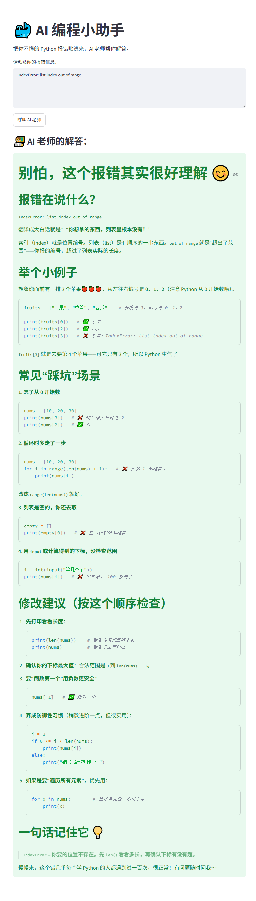

# 🐳 AI 编程教学助手 (AI Programming Tutor)

这是一个专为编程初学者（尤其是少儿编程学生）设计的 AI 报错解释工具。用户只需粘贴 Python 报错信息，系统即可调用大语言模型，以通俗易懂、循循善诱的“老师口吻”给出解答和修改建议。

## 📸 项目演示 (Demo)

## 🛠️ 技术栈 (Tech Stack)
*   **后端 (Backend)**: Python, FastAPI
*   **前端 (Frontend)**: Streamlit
*   **大模型 (LLM)**: DeepSeek API (兼容 OpenAI SDK 格式)
*   **环境管理**: pip

## ✨ 核心功能 (Features)
*   **完整的 CS 架构**：前端 UI 与后端 API 分离，通过 HTTP POST 请求通信。
*   **大模型 Prompt 工程**：定制化 System Prompt，精准约束模型输出格式，避免回答偏离“教育场景”。
*   **响应式前端**：使用 Streamlit 极速构建交互界面，支持 Markdown 格式渲染。

## 🚀 本地运行指南 (Getting Started)

### 1. 克隆项目或下载源码
（如果是本地建的，这步可以略过）

### 2. 安装依赖
确保已安装 Python 3.10+，在终端运行：
\`\`\`bash
pip install fastapi uvicorn streamlit requests openai python-dotenv
\`\`\`

### 3. 配置环境变量 (Environment Variables)
为了保护 API Key 安全，本项目未在代码中硬编码密钥。
在项目根目录下新建一个名为 .env 的文件，并填入你的 DeepSeek API Key：

\`\`\`bash
DEEPSEEK_API_KEY=sk-你的真实密钥填在这里
\`\`\`

### 4. 启动后端服务 (FastAPI)
打开一个终端，在项目目录下运行：
\`\`\`bash
uvicorn main:app --reload
\`\`\`
*后端默认运行在 http://127.0.0.1:8000*

### 5. 启动前端界面 (Streamlit)
打开另一个终端（不要关掉后端），在项目目录下运行：
\`\`\`bash
streamlit run app.py
\`\`\`
*前端默认运行在 http://localhost:8501，浏览器将自动打开。*

## 👨‍💻 作者
**夏金俊** (Xia Jinjun)
- 软件工程本科 | 6年编程教育经验
- 正在向 AI 应用开发 / Python 开发 转型
